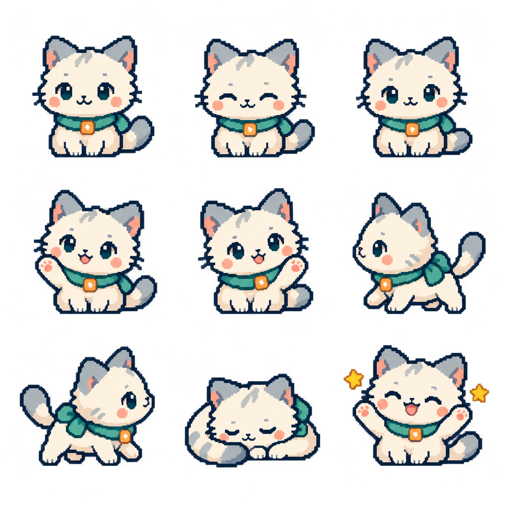

# Lamar Pet

一个带专注计时器的 Windows 像素桌宠。



## 功能

- 桌宠眨眼、呼吸、键鼠互动，休息时睡觉，计时完成时庆祝。
- 左键拖动，轻点一下猫猫会开心回应，右键打开面板，大小可调整为 50%–200%。
- 面板底部显示数据目录，一键打开所在文件夹。
- 专注开始时弹出提示，数秒后自动消失。
- 默认专注 25 分钟、休息 5 分钟，支持调整、暂停、继续和提前结束。
- 专注结束进入休息；休息结束等待手动开始下一轮。
- 关闭面板后，托盘和提醒继续工作。
- 记录每日专注时长和完成轮数，最多保留 90 个日期。
- 新配置默认浅色，支持深色和系统主题。

数据保存在本机，不需要账户或云服务。键鼠采样仅用于动画，不保存按键序列。检测到锁屏或休眠会暂停计时，重启后也恢复为暂停状态。

## 下载

[下载 Windows x64 EXE](https://github.com/lamar666666/lamar-pet/releases/latest/download/lamar-pet.exe)，双击即可运行。

## 运行与构建

当前支持 Windows x64。源码使用 Rust 1.97.1 和 GPUI Kit。

构建需要 Rust、Visual Studio Build Tools 的 C++ 桌面开发组件及 Windows SDK。

```powershell
cargo run --locked
cargo test --locked
cargo clippy --locked --all-targets -- -D warnings
cargo build --locked --release
```

程序位于 `target/release/lamar-pet.exe`，角色资源已嵌入程序。关闭面板不会退出程序；退出请使用托盘菜单。

## 数据与恢复

数据目录为 `%LOCALAPPDATA%/cn.lamarlog.lamar-pet.sprite`。

`focus.json` 保存设置、会话和统计，`focus.json.bak` 保留上一份有效文件。状态切换、正常退出及运行期间每 15 秒保存。异常退出可能损失最近 15 秒。

遇到读取失败、损坏文件或不支持的数据版本时，程序停止覆盖并重试。修复前请先备份原文件；可用备份替换损坏的 `focus.json`。保存失败时保留现有文件并显示提示。

## 来源与许可

代码和项目角色资源采用 [Apache-2.0](LICENSE)。界面使用 [GPUI Kit](https://github.com/longbridge/gpui-kit)，桌面交互思路参考 [BongoCat](https://github.com/ayangweb/BongoCat)。第三方依赖保留各自许可证。

角色精灵图由 AI 辅助生成，程序采用普通 PNG 精灵帧，没有 Live2D SDK 或第三方角色模型。详见 [NOTICE](NOTICE.md)。